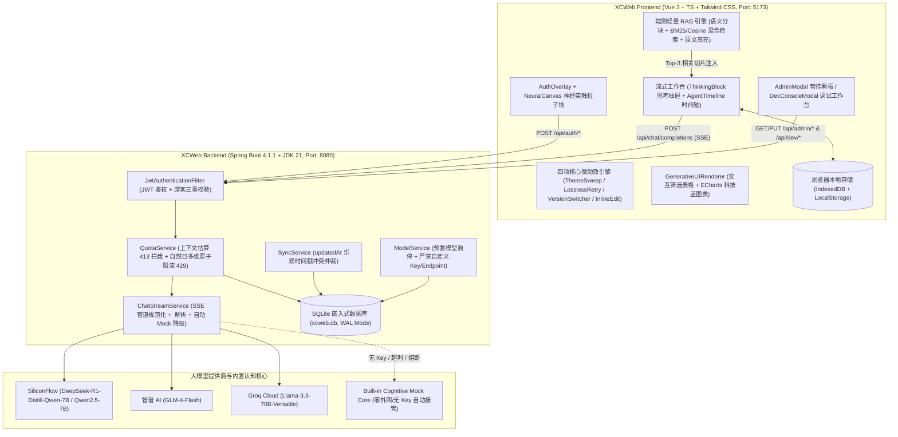

# XCWeb（Xtreme Cognitive Web）

> **智启未来 · 面向 AI-Native 交互场景的 Web 对话与智能体平台**  
> **Electric Cyber Blue 视觉系统 · 四级角色配额防刷 · 深度思考与智能体管线 · 端侧轻量 RAG**

| 维度 | 规格详情 |
| :--- | :--- |
| **产品名称** | XCWeb（Xtreme Cognitive Web） `v1.0.0` |
| **前端技术栈** | Vue 3.5 + TypeScript 5.7（严格模式）+ Vite 6 + Tailwind CSS + Pinia + ECharts 5 + Marked + Highlight.js |
| **后端技术栈** | Spring Boot 4.1.1 + JDK 21（Virtual Threads）+ Spring Security + WebFlux (`WebClient`) + Spring JDBC |
| **数据库引擎** | SQLite 嵌入式数据库（`WAL` 高并发日志模式 + `busy_timeout=5000` 自动初始化建表） |
| **视觉设计系统** | 科技深邃蓝（Electric Cyber Blue：`#2563EB` → `#3B82F6` → `#06B6D4`），支持明亮 / 暗黑 / 无痕三种主题 |
| **代码仓库** | `https://github.com/gyb0619/XCWeb.git` |

---

## 1. 产品背景与核心定位

当前多数大模型 Web 界面仍停留在“单轮文字聊天套壳”阶段，普遍面临三大工程痛点：
1. **交互体验粗糙**：缺少桌面级丝滑过渡微动效，流式输出易抖动，推理模型的思维链（Chain-of-Thought）与正文混杂。
2. **权限与配额机制缺失**：难以在“免登录零门槛体验”与“网关防刷保护”之间取得平衡，且多设备历史会话无法增量同步。
3. **AI 能力停留在表层**：缺少任务规划（Agent 时间轴）、端侧隐私知识增强（Client-Side RAG）和结构化数据动态渲染（Generative UI）。

**XCWeb** 致力于构建工程闭环、开箱即用的下一代 AI-Native 对话与智能体平台，在视觉美学、微动效交互、多维安全配额与认知推理深度四个维度实现全面跃升。

---

## 2. 系统总体架构

XCWeb 采用前后端分离架构：前端基于 **Vite 6 + Vue 3 + TypeScript** 构建响应式单页应用；后端为基于 **JDK 21 + Spring Boot 4.1.1** 的独立单体服务，内置 **SQLite（WAL 模式）** 嵌入式数据库，无需安装任何外部数据库或缓存中间件即可一键启动。



---

## 3. 四级角色权限与配额防刷矩阵

系统内置四级角色体系，按默认 `Asia/Shanghai` 时区的自然日 `00:00` 自动重置配额：

| 角色 | 鉴权机制 | 每日调用上限 | 单次上下文上限 | 核心功能权限 | 数据存储策略 |
| :--- | :--- | :--- | :--- | :--- | :--- |
| **游客 (`guest`)** | 服务端签名匿名令牌 + 浏览器指纹哈希 (`X-Fingerprint`) + 客户端 IP | **10 次 / 日**<br>*(同 IP 上限 30 次/日)* | **4,000 Tokens** | 基础流式对话、深度思考展示、Agent 时间轴、端侧 RAG | 仅存于浏览器本地 `IndexedDB`，不支持云端同步与无痕模式 |
| **普通用户 (`user`)** | 账号密码登录，签发 7 天有效期 JWT | **50 次 / 日** | **16,000 Tokens** | 无痕隐私模式、SQLite 云端双向同步、个性化全局 Prompt、多版本回答管理 | 本地 `IndexedDB` + 后端 `SQLite` 自动增量同步 |
| **管理员 (`admin`)** | 特权账号（仅服务端环境变量初始化，不开放注册） | **不限次数** | **不限长度** | 服务端预置模型启停与默认模型设置、全局 7 日配额与角色分布看板 | 云端双向同步 |
| **开发者 (`dev`)** | 特权账号（仅服务端环境变量初始化，不开放注册） | **不限次数** | **不限长度** | **Dev Console**：脱敏 API 请求审计、7×24h Token 消耗热力图、Prompt 调优沙箱、Agent 决策追踪与快照导出 | 云端双向同步，支持导出脱敏 JSON 快照 |

### 游客三重防刷与配额安全机制
1. **匿名令牌签发防刷**：首次访问调用 `POST /api/auth/guest` 上报硬件指纹哈希，签发 30 天有效期 `HMAC-SHA256` 匿名令牌；同一指纹或同一 IP 每日最多签发 **5 个** 匿名令牌（超限返回 `429 TOKEN_ISSUE_LIMIT_EXCEEDED`）。
2. **请求态三重绑定校验**：每次请求校验令牌签名（篡改返回 `401 INVALID_TOKEN`）及请求头 `X-Fingerprint` 与令牌内嵌指纹的一致性（缺失或不匹配返回 `403 FINGERPRINT_MISMATCH`）。
3. **三维度独立计数**：分别按 `guest:{guestId}`（10 次/日）、`fp:{fingerprintHash}`（10 次/日）、`ip:{clientIp}`（30 次/日）独立统计，**任一维度触顶即返回 `429 QUOTA_EXCEEDED`**，更换匿名令牌无法绕过指纹或 IP 限制。
4. **上下文预检不扣配额**：对话进入上游前估算上下文 Token 数，超出角色上限（游客 4K / 用户 16K）直接返回 `413 CONTEXT_TOO_LONG`，**不扣减当日调用次数**。
5. **精准 Token 记账**：流结束后按上游返回的实际 `usage.total_tokens` 写入 `quota_logs.token_count`；Mock 降级响应计入调用次数，但**不计入 Token 消耗统计**。

---

## 4. 四项桌面级微动效与三项 AI 技术创新

### 4.1 品牌视觉与登录粒子场（`NeuralCanvas.vue` + `AuthOverlay.vue`）
- **延迟初始化保障 FCP ≤ 1.2s**：首屏先直出深邃蓝径向渐变基底，在 `requestAnimationFrame` + `requestIdleCallback` 后再启动 Canvas 2D 粒子渲染。
- **光标引力与突触流光**：光标靠近粒子时产生微引力牵引与 `#2563EB` → `#06B6D4` 渐变流光脉冲节点。
- **无障碍自动降级**：检测到系统开启 `prefers-reduced-motion: reduce` 或低并发核心设备时，自动降级为静态深邃蓝网格背景。

### 4.2 四项核心微动效（稳态帧率 55–60 FPS）
| 动效名称 | 实现模块 | 技术与交互规范 |
| :--- | :--- | :--- |
| **1. 对角线扫屏切换主题** | `useThemeSweep.ts`<br>`ThemeSweepOverlay.vue` | 切换明亮 / 暗黑 / 无痕模式时，全屏 SVG Polygon 配合 `clip-path` 沿 **135° 对角线方向**从左上扫向右下，严格耗时 **500ms**，锋面过半时无缝切换 CSS 变量，零闪烁撕裂。 |
| **2. 无损历史重试与飞移** | `useLosslessRetry.ts` | 点击历史提问【无损重试】时，**不截断、不删除后续对话**；原提问气泡向左偏移 **150px** 并弱化；克隆副本 `.message-retry-replica` 沿三次贝塞尔曲线以 **600ms** 飞向底部输入框；新回答作为第 2 页追加至版本切换器。 |
| **3. 视差版本翻页** | `VersionSwitcher.vue` | 切换多版本回答时，旧版本以 **150ms** 滑出淡出，新版本以 **150px 摆幅**带弹性阻尼 `cubic-bezier(0.34, 1.56, 0.64, 1)` 滑入；底部控制栏保持原位 DOM 不重建，页码文字带 `filter: blur(3px)` 微调过渡。 |
| **4. 自适应内联编辑** | `useInlineEdit.ts` | 编辑历史提问时，通过 `getBoundingClientRect()` 动态测量气泡起止宽高，驱动 CSS `transition` 平滑展开为全宽编辑框，保存或取消时平滑收拢回原位并生成新回答分支。 |

### 4.3 深度思考抽屉与三项 AI 创新模块
1. **深度思考规范化抽屉 (`ThinkingBlock.vue`)**：
   - 后端统一将上游 `<think>...</think>` 标签或 `reasoning_content` 转换为 `event: thinking` SSE 增量流。
   - 思考进行中显示科技蓝旋转指示器与 `0.1s` 精度实时计时器；思考完成瞬间旋转器模糊淡出，翠绿微光对勾弹性放大浮入，并联动触发正文容器 **600ms `slideUp` 自下而上滑升动效**。
2. **Agent 可视化思考时间轴 (`AgentTimeline.vue`)**：
   - 在回答上方展示 `规划 (Plan) → 工具调用 (Tool Call) → 数据回传 (Data Return) → 总结分析 (Synthesis)` 四阶段交互式节点，点击任一节点可展开查看工具名、输入参数、回传结果与毫秒级耗时。所有工具均受服务端白名单管控。
3. **端侧轻量 RAG 知识检索 (`useClientRAG.ts` + `RagPreviewModal.vue`)**：
   - 支持上传本地 Markdown / 文本 / 代码文件或一键挂载内置《XCWeb 2026 技术白皮书》，在浏览器内存中执行 **380 字符滑动窗口语义分块（64 字符重叠）**。
   - 提问时在浏览器端执行 **BM25 + 词向量余弦相似度（Cosine Similarity）混合检索**，提取 Top-3 切片注入上下文；回答中渲染可点击的 `【引用来源 [1]】` `【引用来源 [2]】` 徽章，点击立即打开预览弹窗并自动滚动高亮原文段落，**原始文件全程零上传服务器**。
4. **生成式交互 UI (`GenerativeUIRenderer.vue`)**：
   - 自动识别回答中的 Markdown 结构化表格，动态渲染为支持**关键词实时过滤、多列升降序排序、CSV 导出**的交互式表格，并可一键切换为 **ECharts 科技深邃蓝柱状图 / 折线图**。

---

## 5. 环境要求与一键启动指南

### 5.1 运行环境要求
- **Java 环境**：JDK `21`（推荐 `21.0.x`）
- **构建工具**：Maven `3.9+`（工程已兼容标准 Maven 命令）
- **前端环境**：Node.js `20.x+` 与 `npm 10+`
- **数据库**：无需安装外部数据库（内置 `sqlite-jdbc`，启动时自动在运行目录生成 `xcweb.db` 并初始化全部 7 张核心业务表与状态表）

### 5.2 环境变量配置（可选，零配置亦可直接离线运行）
复制根目录下的 `.env.example` 为环境变量或在终端导出。若未配置任何第三方大模型 API Key，系统将**100% 自动无缝降级至内置 `Built-in Cognitive Mock Core`**，完整演示深度思考、Agent 时间轴、端侧 RAG 引用与生成式图表。

```powershell
# PowerShell 示例（可选配置真实免费模型 Key 与管理员/开发者初始口令）
$env:XCWEB_ADMIN_PASSWORD="YourStrongAdminPassword!2026"
$env:XCWEB_DEV_PASSWORD="YourStrongDevPassword!2026"
$env:SILICONFLOW_API_KEY="sk-..."   # 留空则自动启用内置 Cognitive Mock 引擎
```

### 5.3 启动后端服务（Port: `8080`）
```powershell
cd D:\Code\Other\XCWeb\backend
mvn spring-boot:run
```

### 5.4 启动前端开发服务器（Port: `5173`）
```powershell
cd D:\Code\Other\XCWeb\frontend
npm install
npm run dev
```
浏览器访问 `http://localhost:5173` 即可进入 XCWeb 平台（Vite 已配置 `/api` 自动代理至 `http://localhost:8080`）。

---

## 6. 自动化测试与编译核验命令

### 6.1 前端 TypeScript 严格模式检查与生产构建
```powershell
cd D:\Code\Other\XCWeb\frontend
npx vue-tsc --noEmit
npm run build
```
- **验收标准**：`0 errors, 0 warnings`，产生物理分包产物（`vendor-vue`、`vendor-echarts`、`vendor-markdown`、`index`）。

### 6.2 后端全链路 JUnit 5 集成测试套件
```powershell
cd D:\Code\Other\XCWeb\backend
mvn test
```
- **覆盖范围**（`XcWebBackendIntegrationTests` 共 7 大核心验收测试）：
  1. 游客三重校验（篡改令牌返回 `401`，指纹缺失或不匹配返回 `403`）；
  2. 游客匿名令牌每日签发防刷上限（同指纹/IP 第 6 次申请返回 `429 TOKEN_ISSUE_LIMIT_EXCEEDED`）；
  3. 游客上下文超 `4,000 Tokens` 返回 `413 CONTEXT_TOO_LONG` 且不扣减当日调用次数；
  4. 游客连续 10 次流式对话成功（含自动 Mock 降级、`agent_step`/`thinking`/`content`/`usage`/`done` 事件流与 RAG 引用），第 11 次返回 `429 QUOTA_EXCEEDED`；切换新令牌仍被同指纹/IP 维度拦截；
  5. 管理员预置模型启停与默认模型切换，注入自定义 `apiKey`、`endpoint` 或非预置模型 ID 被 `400` 拒绝；
  6. 普通用户注册角色强制约束、`updatedAt` 云端同步冲突仲裁（`server_newer`），以及 `/api/dev/requests` 敏感头与凭证严格脱敏；
  7. 普通用户 `16,000 Tokens` 上下文上限校验，Mock 调用不计入 Token 统计，真实 `usage` 精确累加至 `quota_logs.token_count`。

---

## 7. 项目交付文档索引

| 文档路径 | 说明 |
| :--- | :--- |
| [`docs/PRD.md`](docs/PRD.md) | 《XCWeb 产品需求文档 v1.0.0》 |
| [`docs/XCWeb_Prompts.md`](docs/XCWeb_Prompts.md) | 《XCWeb 产品需求概要与多子代理协同手册》 |
| [`docs/PROMPTS.md`](docs/PROMPTS.md) | 《XCWeb 多智能体协同开发与阶段指令规范》 |
| [`docs/API_CONTRACT.md`](docs/API_CONTRACT.md) | 《XCWeb 前后端架构与接口契约规范》 |
| [`.env.example`](.env.example) | 服务端全量环境变量配置模板 |
