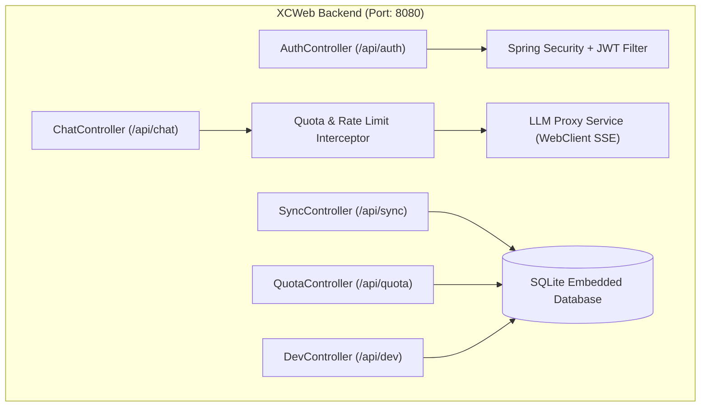

# XCWeb (Xtreme Cognitive Web) —— 产品需求文档 (PRD)

> **竞赛命题**：全国高校 AI Web 开发挑战赛 —— “智启未来：AI驱动的Web应用创新挑战”  
> **版本**：v1.0.0-Release  
> **代号**：XCWeb (Xtreme Cognitive Web)  
> **技术栈**：Vue 3 + TypeScript + Tailwind CSS (Vite) + Spring Boot 3 (Java 17/21) + SQLite  
> **代码仓库**：https://github.com/gyb0619/XCWeb.git  

---

## 1. 文档概述与项目背景

### 1.1 项目背景
2026年，大语言模型与智能体技术正在重塑现代 Web 交互范式。传统的大模型 Web 界面多为简陋的套壳聊天机器人，存在三大普遍痛点：
1. **交互生硬**：缺乏桌面级的交互手感与流畅微动效，流式响应卡顿，思维链暴露混乱。
2. **缺乏工程化权限与配额隔离**：无法兼顾免登录体验与滥用防护，多端同步困难。
3. **AI 赋能浮于表面**：仅仅是简单的单轮/多轮文字问答，缺乏自主规划 Agent、端侧知识库增强（RAG）和动态多模态渲染能力。

### 1.2 产品定位与愿景
**XCWeb** 是一款面向下一代 AI Native 交互标准的极客级 Web 对话与智能体平台。
- **视觉风格**：由原项目的金色系全面进化为**“科技深邃蓝 (Electric Cyber Blue)”**，具备沉浸式深色微光与毛玻璃质感。
- **极致动效**：完整继承并升级原项目的“对角线扫屏切主题”、“无损重试物理飞移动画”、“大摆幅视差翻页”与“自适应平滑尺寸展开编辑”。
- **工程闭环**：采用前后端完全独立的单体 Spring Boot 架构，内置 SQLite 数据库，开箱即用，内置四级角色权限体系（游客-普通用户-管理员-开发者）与滑动窗口 Token 配额控制。
- **AI 深度突破**：深度适配 DeepSeek 推理模型思维链、接入免费第三方大模型 API，并扩展轻量 Agent 工具调用与端侧 RAG 检索增强。

---

## 2. 用户角色体系与配额策略 (Role & Quota Matrix)

系统构建四级细粒度权限模型，并在 Spring Boot 后端建立统一配额拦截器：

```
                    ┌──────────────┐
                    │  客户端请求   │
                    └──────┬───────┘
                           │
                 [角色鉴权与身份识别]
                           │
       ┌───────────┬───────┴───────┬───────────┐
       ▼           ▼               ▼           ▼
   【游客】     【普通用户】     【管理员】   【开发者】
  (浏览器指纹)   (账号 JWT)      (Admin JWT)  (Dev JWT)
       │           │               │           │
   限制:10次/天  限制:50次/天     无限制调用    无限制调用
   单次:4K Token 单次:16K Token   模型管理CRUD 开发者控制台
       │           │               │           │
       └───────────┼───────────────┴───────────┘
                   ▼
       [配额拦截器 RateLimiter]
         ├─ 超额: 429 友善拦截并引导
         └─ 正常: 放行 -> LLM 聚合代理 -> 流式统计 Token
```

### 2.1 角色权限与配额对照表

| 权限等级 | 鉴权认证机制 | 每日对话次数 | 单次上下文上限 | 核心功能特权 | 存储持久化策略 |
| :--- | :--- | :--- | :--- | :--- | :--- |
| **游客 (Guest)** | 浏览器指纹 (UUID) + 客户端 IP | **10 次 / 日** | 4,000 Tokens | 基础模型体验、深度思考解析展示 | 仅浏览器本地存储 (IndexedDB)，不可云同步，无无痕模式 |
| **普通用户 (User)** | 账号密码注册 / 登录下发 JWT | **50 次 / 日** | 16,000 Tokens | 解锁无痕临时对话、解锁云端双向同步、个性化全局 Prompt、多版本管理 | 自动双向同步至后端 SQLite |
| **管理员 (Admin)** | 特权账号 (`role = admin`) | **无限制** | 无限制 | 全功能大模型配置 CRUD（支持任意自定义 API/Key）、全局配额监视看板 | 完整云端同步 + 保护性合并 |
| **开发者 (Developer)**| 特权账号 (`role = dev`) | **无限制** | 无限制 | 独享 **Dev Console**（原始 API 请求查看、Prompt 调优沙箱、Token 消耗热力图、Agent 决策追踪） | 完整云端同步 + 开发者调试数据导出 |

### 2.2 超额拦截体验
- **游客超额**：弹出优雅科技蓝玻璃卡片：“*今日游客体验额度已用尽（10/10次）。注册登录即可立享 5 倍额度并开启云端存档！*”，提供【立即登录/注册】快捷入口。
- **用户超额**：气泡提示：“*今日免费对话配额已达上限（50/50次），将于次日 00:00 自动重置。*”。

---

## 3. 第三方免费 AI API 接入与降级方案

为了在无需参赛者付费的前提下保证评审与日常体验的高可用性，Spring Boot 后端统一封装 OpenAI 兼容代理层：

### 3.1 推荐免费 API 矩阵

| 提供商 | 模型标识 | 免费策略与优势 | 用途分配 |
| :--- | :--- | :--- | :--- |
| **硅基流动 (SiliconFlow)** | `deepseek-ai/DeepSeek-R1-Distill-Qwen-7B`<br/>`Qwen/Qwen2.5-7B-Instruct` | 注册赠送海量 Token，部分小规格模型永久免费；原生支持 `<think>` 标签 | **默认主力模型 (支持思维链)** |
| **智谱 AI (BigModel)** | `glm-4-flash` | **完全永久免费**；支持 128K 超长上下文；API 稳定 | **长文分析与快速问答备用** |
| **Groq Cloud** | `llama-3.3-70b-versatile` | 免费公测；300+ Tokens/s 极致流式输出 | **代码编写与极速响应** |
| **本地内置 Mock 降级** | `mock-cognitive-core` | 无网络或未配 Key 时自动切换，模拟 DeepSeek 思考与打字机输出 | **评委离线评审兜底保护** |

---

## 4. 前端产品设计与高阶交互规范

### 4.1 全新科技深邃蓝设计系统 (Electric Cyber Blue)
- **配色基调**：
  - 主色（Primary）：`#2563EB` (Royal Blue) 到 `#3B82F6` (Electric Blue)
  - 霓虹辅助色（Accent）：`#06B6D4` (Cyber Cyan)
  - 背景底色（Background）：
    - 明亮模式：`#F8FAFC`（极净浅灰蓝）搭配纯白卡片 `#FFFFFF`
    - 暗黑模式：`#0B0F19`（宇宙暗夜蓝黑）搭配深蓝微透卡片 `#111827`
    - 无痕模式：`#07090E` 搭配星空靛蓝 `#6366F1`
- **毛玻璃景深**：弹窗与遮罩层应用 `backdrop-blur-md`（8px - 16px 二次毛玻璃模糊），配以科技微光内描边。

### 4.2 全新科技感登录/注册面板
- **视觉去卡通化**：移除旧版的卡通吉祥物，替换为现代极客感 **Canvas 神经突触连线微粒粒子场**。
- **卡片架构**：
  - 居中悬浮极简玻璃拟态卡片；
  - 顶部品牌标识：**XCWeb** 矢量流光 Logo + “智启未来 · 极客 AI 对话与工程化创新平台”；
  - 登录 / 注册 / 快捷体验 Tab 切换带胶囊滑块阻尼过渡；
  - 提供显著的**【以游客身份体验】**一键免登通道，直通主聊天界面。

### 4.3 四大核心交互微动效规范
1. **对角线一步式扫屏切主题 (Theme Sweep)**：
   - 切换主题时，全屏覆盖 SVG Polygon，以 `clip-path` 沿 135° 对角线从左上滑向右下；
   - 动画执行 500ms，动画期间保持 60fps 平滑过渡并无缝完成样式变量切换。
2. **无损历史重试与物理飞移动画 (Lossless Retry & Fly-in)**：
   - 重试历史提问时不截断、不删除后续对话；
   - 原提问气泡向左偏移 150px 弱化，克隆副本（`.message-retry-replica`）以 600ms 物理抛物线贝塞尔曲线飞向屏幕底部新输入行；
   - 底部生成的 AI 回复组件自动激活版本切换器（Page 1 为原回答，Page 2 为本次重试流式生成）。
3. **大摆幅视差翻页 (Parallax Version Switcher)**：
   - 左右翻阅回答版本时，旧版本以 150ms 滑出淡出，新版本以 150px 大摆幅带弹性阻尼滑入；
   - 底栏控制栏原地消模糊微调，避免组件整体重构闪烁。
4. **动态平滑尺寸测量内联编辑 (Auto-Layout Inline Editing)**：
   - 点击修改旧提问时，JS 实时测量气泡起始尺寸与编辑框撑满尺寸，利用 CSS transition 平滑拉伸为全宽输入框；
   - 保存或取消时，输入框原位缩放淡出，测量目标气泡尺寸，平滑折叠收拢回小气泡。

### 4.4 深度思考 (DeepSeek `<think>`) 渲染规范
- 流式接收时自动捕获 `<think>` 标签，输出到独立的思考路径抽屉中；
- 思考中状态：科技蓝旋转菊花 + 实时思考计时器；
- 思考结束瞬时：菊花模糊淡出，绿色对勾微光放大浮入；
- 思考抽屉支持平滑折叠/展开；思考完成后，正式回答正文执行 600ms 自下而上滑升动效（`slideUp`）。

---

## 5. 独立后端 (Spring Boot 3) 系统架构与接口规范

后端完全独立部署，不依赖外部认证服务，核心包含六大控制器与服务：



### 5.1 核心 API 接口清单

| 方法 | 路径 | 鉴权等级 | 描述 |
| :--- | :--- | :--- | :--- |
| `POST` | `/api/auth/register` | 公开 | 用户注册 (用户名/邮箱/密码) |
| `POST` | `/api/auth/login` | 公开 | 用户登录，下发 JWT (有效期 7 天) |
| `GET`  | `/api/auth/me` | User/Admin/Dev | 获取当前登录用户的角色、昵称及配额状态 |
| `POST` | `/api/chat/completions` | Guest/User/Admin/Dev | **核心流式对话**（SSE 协议，支持四级配额拦截） |
| `GET`  | `/api/quota/status` | Guest/User/Admin/Dev | 查询今日已用次数、Token 消耗量与重置倒计时 |
| `GET`  | `/api/sync/conversations` | User/Admin/Dev | 获取云端会话列表（增量拉取） |
| `POST` | `/api/sync/conversations` | User/Admin/Dev | 上报/更新单个会话（按 `updatedAt` 时间戳仲裁） |
| `DELETE`| `/api/sync/conversations/{id}` | User/Admin/Dev | 删除指定云端会话 |
| `GET`  | `/api/sync/settings` | User/Admin/Dev | 获取云端个性化设置 |
| `PUT`  | `/api/sync/settings` | User/Admin/Dev | 保存云端个性化设置 (管理员自动合并模型配置) |
| `GET`  | `/api/dev/metrics` | Dev 专属 | 开发者仪表盘数据 (API 吞吐量、Token 消耗热力图) |

### 5.2 数据库核心表结构 (SQLite)

```sql
-- 用户表
CREATE TABLE IF NOT EXISTS users (
    id INTEGER PRIMARY KEY AUTOINCREMENT,
    username VARCHAR(50) UNIQUE NOT NULL,
    email VARCHAR(100) UNIQUE,
    password_hash VARCHAR(255) NOT NULL,
    role VARCHAR(20) NOT NULL DEFAULT 'user', -- 'guest', 'user', 'admin', 'dev'
    created_at TIMESTAMP DEFAULT CURRENT_TIMESTAMP
);

-- 配额与使用记录表
CREATE TABLE IF NOT EXISTS quota_logs (
    id INTEGER PRIMARY KEY AUTOINCREMENT,
    identifier VARCHAR(100) NOT NULL, -- 用户ID 或 游客指纹
    role VARCHAR(20) NOT NULL,
    date_str VARCHAR(10) NOT NULL,    -- 例如 '2026-10-28'
    call_count INTEGER DEFAULT 0,
    token_count INTEGER DEFAULT 0,
    updated_at TIMESTAMP DEFAULT CURRENT_TIMESTAMP,
    UNIQUE(identifier, date_str)
);

-- 会话表
CREATE TABLE IF NOT EXISTS conversations (
    id VARCHAR(64) PRIMARY KEY,
    user_id INTEGER NOT NULL,
    title VARCHAR(200) NOT NULL,
    token VARCHAR(32) NOT NULL,
    model VARCHAR(100) NOT NULL,
    created_at BIGINT NOT NULL,
    updated_at BIGINT NOT NULL,
    FOREIGN KEY(user_id) REFERENCES users(id) ON DELETE CASCADE
);

-- 消息表
CREATE TABLE IF NOT EXISTS messages (
    id VARCHAR(64) PRIMARY KEY,
    conversation_id VARCHAR(64) NOT NULL,
    role VARCHAR(20) NOT NULL, -- 'user', 'assistant', 'system'
    content TEXT NOT NULL,
    thinking_content TEXT,
    attachments_json TEXT,
    versions_json TEXT,        -- 多版本答复 JSON 数组
    created_at BIGINT NOT NULL,
    FOREIGN KEY(conversation_id) REFERENCES conversations(id) ON DELETE CASCADE
);
```

---

## 6. 竞赛亮点功能设计 (冲刺国赛一等奖专项)

大赛评分体系中 **“AI 技术深度 (35%)”** 与 **“创新性 (25%)”** 占 60% 的决定性权重。为此，XCWeb 额外规划三大差异化竞赛创新模块：

1. **AI Agent 可视化思考时间轴 (Agent Thought Timeline)**：
   - 在对话中若触发工具（如天气查询、代码执行沙箱、网页检索），对话气泡上方展示可交互的步骤时间轴：`规划 -> 工具调用 -> 数据回传 -> 总结分析`，极大提升 AI 深度分。
2. **端侧轻量 RAG 知识检索 (Client-Side Document RAG)**：
   - 用户拖入长文本/论文/代码文件时，前端本地进行语义分块与倒排/向量匹配；提问时自动拼接关联段落，并在回答中附带【引用来源 [1] [2]】高亮点击跳转。
3. **生成式交互 UI (Generative UI Component)**：
   - 当大模型生成包含结构化数据时（如表格、对比分析），前端动态渲染为可筛选交互式表格或 ECharts 动态科技蓝折线/柱状图，而不是死板的文字排版。

---

## 7. 交付要求与验收标准

1. **工程质量标准**：
   - 前端代码遵循 ESLint + Prettier + TypeScript 严格模式，零 TypeScript 编译错误。
   - 后端 Spring Boot 采用 Maven 标准结构，无复杂外部安装依赖，`mvn spring-boot:run` 一键启动。
2. **性能与体验标准**：
   - 首屏加载（FCP）在 1.2 秒内完成。
   - 视图过渡动效稳态保持在 55-60 FPS，无丢帧卡顿。
3. **评审材料规范**：
   - 包含符合竞赛标准的 30 页架构设计与开发技术白皮书（PDF）。
   - 包含 5-8 分钟 1080P 高清演示讲解视频。
