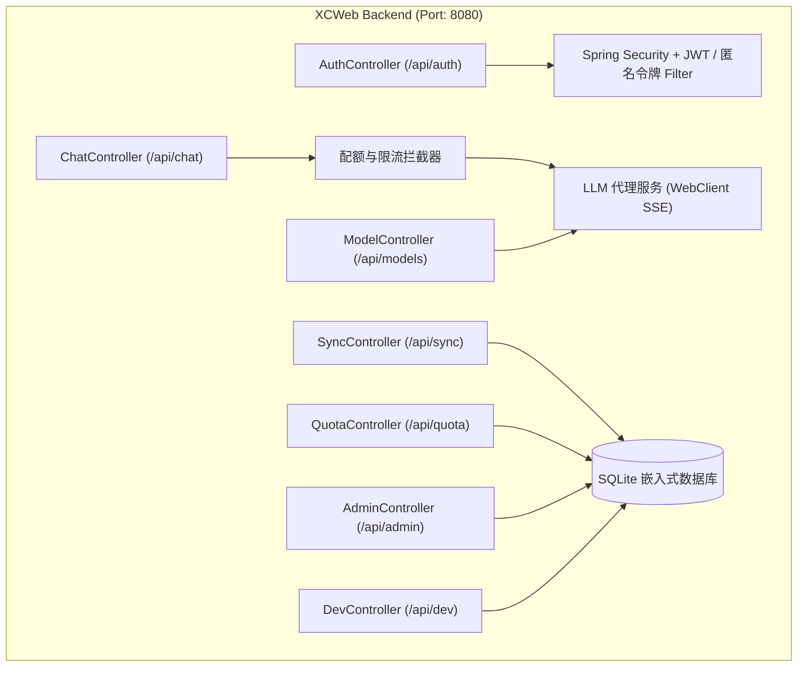

# XCWeb（Xtreme Cognitive Web）产品需求文档（PRD）

| 项目 | 内容 |
| :--- | :--- |
| 产品名称 | XCWeb（Xtreme Cognitive Web） |
| 文档版本 | v1.0.0 |
| 产品定位 | 面向 AI Native 交互场景的 Web 对话与智能体平台 |
| 技术栈 | 前端：Vue 3 + TypeScript + Tailwind CSS（Vite）<br>后端：Spring Boot 4.1.1 + JDK 21 + Maven<br>数据库：SQLite（嵌入式） |
| 代码仓库 | https://github.com/gyb0619/XCWeb.git |

---

## 1. 文档概述

### 1.1 项目背景

大语言模型与智能体技术正在改变 Web 应用的交互方式。当前多数大模型 Web 界面仍停留在“聊天套壳”阶段，主要存在以下问题：

1. **交互体验粗糙**：缺少桌面级的交互手感与连贯的过渡动效，流式输出易卡顿，思维链内容与正文混杂。
2. **权限与配额机制缺失**：难以在“免登录体验”与“防止滥用”之间取得平衡，且多端数据无法同步。
3. **AI 能力停留在表层**：多为单轮或多轮文字问答，缺少任务规划（Agent）、端侧知识增强（RAG）和结构化内容的动态渲染能力。

### 1.2 产品定位与目标

XCWeb 是一个具备工程化权限体系的 AI 对话与智能体平台，目标如下：

- **视觉风格**：采用“科技深邃蓝（Electric Cyber Blue）”设计系统，以深色背景、微光和毛玻璃质感为基调。
- **交互体验**：提供四项核心微动效（主题扫屏切换、无损历史重试、视差版本翻页、自适应内联编辑），并保证动画流畅度。
- **工程闭环**：前后端分离部署；后端为单体 Spring Boot 应用，内置 SQLite，无需额外安装数据库即可运行；内置四级角色权限与按日配额控制。
- **AI 能力**：适配推理模型的思维链输出，接入免费大模型 API，并提供 Agent 思考时间轴、端侧轻量 RAG 与生成式交互 UI。

### 1.3 术语说明

| 术语 | 说明 |
| :--- | :--- |
| 深度思考 / 思维链 | 推理模型在给出正文前输出的推理过程，本文统一称“深度思考” |
| 匿名令牌 | 游客首次进入时由服务端签发的签名令牌，用于标识游客会话 |
| 配额 | 按自然日统计的对话调用次数上限 |
| Mock 降级 | 上游模型不可用时，由后端内置的模拟模型提供响应 |

---

## 2. 用户角色体系与配额策略

系统设置四级角色，并由后端统一的配额拦截器执行限制。

```
                    ┌──────────────┐
                    │  客户端请求   │
                    └──────┬───────┘
                           │
                 [身份识别与角色鉴权]
                           │
       ┌───────────┬───────┴───────┬───────────┐
       ▼           ▼               ▼           ▼
   【游客】     【普通用户】     【管理员】   【开发者】
 (匿名令牌+指纹+IP)  (账号 JWT)   (Admin JWT)  (Dev JWT)
       │           │               │           │
  10 次 / 日    50 次 / 日       不限次数      不限次数
  单次 4K Token  单次 16K Token  不限          不限
       │           │               │           │
       └───────────┼───────────────┴───────────┘
                   ▼
          [配额拦截器 RateLimiter]
         ├─ 超额：返回 429 并给出引导
         └─ 正常：放行 → LLM 代理 → 流式输出 → 结束后按实际 usage 计入 Token
```

### 2.1 角色权限与配额对照

| 角色 | 鉴权方式 | 每日对话次数 | 单次上下文上限 | 功能权限 | 数据存储 |
| :--- | :--- | :--- | :--- | :--- | :--- |
| 游客（Guest） | 匿名令牌 + 浏览器指纹 + 客户端 IP | 10 次 | 4,000 Tokens | 基础对话、深度思考展示 | 仅存于浏览器本地（IndexedDB），不支持云端同步与无痕模式 |
| 普通用户（User） | 账号密码登录，下发 JWT | 50 次 | 16,000 Tokens | 无痕临时对话、云端双向同步、全局个性化 Prompt、多版本回答管理 | 自动同步至后端 SQLite |
| 管理员（Admin） | 特权账号（`role = admin`） | 不限 | 不限 | 模型启停与默认模型设置（仅限服务端预置模型）、全局配额监控看板 | 云端同步 |
| 开发者（Developer） | 特权账号（`role = dev`） | 不限 | 不限 | Dev Console：原始 API 请求查看、Prompt 调优沙箱、Token 消耗热力图、Agent 决策追踪 | 云端同步，支持导出调试数据 |

补充规则：

- **账号创建**：公开注册接口只能创建 `user` 角色账号；`admin` 与 `dev` 账号仅能通过服务端配置或初始化脚本创建，不开放注册。
- **上下文上限校验**：请求进入上游调用前，由后端对提交的上下文做 Token 估算；超出当前角色上限时返回 `413`（`CONTEXT_TOO_LONG`），不消耗对话次数。
- **每日重置**：配额按自然日统计，默认使用 `Asia/Shanghai` 时区的 00:00 重置，时区可通过配置项修改。
- **自定义模型**：任何角色均不允许自定义模型接口地址或 API Key。可用模型由服务端配置文件统一预置，API Key 通过环境变量注入，不下发至前端。

### 2.2 游客身份与防刷策略

游客无需注册，但需通过以下三重校验建立身份：

1. **匿名令牌**：游客首次进入时，前端调用 `POST /api/auth/guest` 并上报浏览器指纹哈希，服务端校验后签发匿名令牌（有效期 30 天），令牌内包含 `guestId` 与指纹哈希。
2. **指纹一致性**：此后每次请求须携带匿名令牌与指纹哈希，服务端校验两者与令牌内记录一致，不一致则拒绝。
3. **IP 维度计数**：服务端同时按客户端 IP 统计调用次数。

配额按 `guestId`、指纹、IP 三个维度分别计数，**任一维度触及上限即拦截**。其中 IP 维度的阈值高于单游客上限（默认 30 次 / 日，可配置），以兼容校园、企业等共享出口网络。

此外，同一指纹或同一 IP 每日可签发的匿名令牌数量设有上限（默认 5 个，可配置），防止通过反复申请新令牌绕过限制。

> 说明：浏览器指纹存在被伪造的可能，上述措施的目的是显著提高绕过成本，而非提供绝对防护。游客额度属于体验性质，不涉及敏感数据与资金。

### 2.3 超额拦截体验

- **游客超额**：弹出科技蓝玻璃拟态卡片，文案为“今日游客体验额度已用尽（10/10 次）。注册登录即可获得 5 倍额度，并开启云端存档。”，并提供【立即登录 / 注册】入口。
- **用户超额**：以气泡提示“今日免费对话配额已达上限（50/50 次），将于明日 00:00 自动重置。”。
- **接口响应**：超额时返回 `429`，响应体包含 `code`（`QUOTA_EXCEEDED`）、`role`、`used`、`limit`、`resetAt` 字段，供前端渲染对应提示。

### 2.4 配额计量规则

- **调用次数**：请求通过身份与上下文校验后，原子递增当日调用次数；若上游在输出首个有效内容前失败且 Mock 降级也未成功，则回退本次计数。
- **Token 用量**：以上游模型返回的实际 `usage` 为准，在流式输出结束后写入当日 Token 统计。当前 Token 统计用于看板与审计，不作为额度拦截依据。
- **兜底处理**：上游未返回 `usage`（如连接中断）时，按本地估算值计入并标记为估算；Mock 降级响应不计入 Token 统计，但仍计入调用次数，以保持各环境下的行为一致。

---

## 3. 大模型接入与降级方案

后端统一封装 OpenAI 兼容的代理层，所有模型调用均由后端发起。

### 3.1 预置模型矩阵

| 提供商 | 模型标识 | 特点 | 用途 |
| :--- | :--- | :--- | :--- |
| 硅基流动（SiliconFlow） | `deepseek-ai/DeepSeek-R1-Distill-Qwen-7B`<br>`Qwen/Qwen2.5-7B-Instruct` | 提供免费小规格模型；R1 蒸馏模型输出深度思考内容 | 默认主力模型（支持深度思考） |
| 智谱 AI（BigModel） | `glm-4-flash` | 提供免费调用，长上下文能力较强 | 长文分析与快速问答备用 |
| Groq Cloud | `llama-3.3-70b-versatile` | 输出速度快 | 代码编写与低延迟响应 |
| 内置 Mock | `mock-cognitive-core` | 无需网络与 Key，模拟深度思考与打字机输出 | 离线演示与兜底 |

> 各提供商的免费政策、模型名称与额度可能调整，以其官方当前公告为准。

### 3.2 配置与降级规则

- **配置方式**：模型列表、默认模型、各提供商 API Key 在服务端配置文件与环境变量中声明；未配置 Key 的模型不会出现在可用列表中。
- **管理员权限**：管理员可对预置模型执行启用 / 停用并设置默认模型，不能新增、修改接口地址或 Key。
- **降级触发条件**：满足任一条件时自动切换至 Mock：所有预置模型均未配置 Key；上游请求连接或首包超时（超时阈值可配置）；上游连续失败达到设定次数。
- **降级可感知**：降级发生时，SSE 事件中带有 `mock = true` 标识，前端在消息上给予轻量提示。

### 3.3 流式输出规范

- **传输协议**：`POST /api/chat/completions` 返回 `text/event-stream`。因浏览器原生 `EventSource` 仅支持 GET，前端使用 `fetch` + `ReadableStream` 解析。
- **事件类型**：

| 事件 | 含义 |
| :--- | :--- |
| `meta` | 本次响应的模型、是否为 Mock 等元信息 |
| `thinking` | 深度思考内容的增量片段 |
| `content` | 正文内容的增量片段 |
| `usage` | 上游返回的实际 Token 用量（流末尾） |
| `error` | 错误信息（含错误码） |
| `done` | 流结束标识 |

- **深度思考规范化**：后端统一将上游的 `<think>` 标签内容或 `reasoning_content` 字段转换为 `thinking` 事件，前端无需区分模型差异。

---

## 4. 前端产品设计与交互规范

### 4.1 科技深邃蓝设计系统

**配色**

| 用途 | 色值 |
| :--- | :--- |
| 主色（Primary） | `#2563EB`（Royal Blue）至 `#3B82F6`（Electric Blue） |
| 辅助色（Accent） | `#06B6D4`（Cyber Cyan） |
| 明亮模式背景 | 页面 `#F8FAFC`，卡片 `#FFFFFF` |
| 暗黑模式背景 | 页面 `#0B0F19`，卡片 `#111827` |
| 无痕模式 | 背景 `#07090E`，强调色 `#6366F1` |

**质感**：弹窗与遮罩层使用 `backdrop-blur`（模糊半径 8px–16px），配合浅色内描边形成毛玻璃效果。

### 4.2 登录 / 注册页面

- **背景**：Canvas 绘制的神经突触连线粒子场，作为品牌视觉主体。
- **卡片**：居中的玻璃拟态卡片，顶部展示 XCWeb 矢量 Logo 与标语“智启未来 · AI 对话与智能体平台”。
- **Tab 切换**：登录 / 注册 / 快捷体验三个标签，切换时胶囊滑块带阻尼过渡。
- **游客入口**：提供显著的【以游客身份体验】按钮，点击后获取匿名令牌并直接进入主聊天界面。
- **性能与无障碍**：粒子背景在首屏渲染完成后再初始化；检测到系统开启“减少动态效果”（`prefers-reduced-motion`）或设备性能不足时，降级为静态渐变背景。

### 4.3 四项核心微动效规范

| 动效 | 触发 | 规范 |
| :--- | :--- | :--- |
| 对角线扫屏切换主题 | 切换明暗 / 无痕主题 | 全屏 SVG Polygon 通过 `clip-path` 沿 135° 方向从左上扫向右下，时长 500ms；扫屏期间无缝完成主题变量切换 |
| 无损历史重试与飞移 | 重试历史提问 | 不截断、不删除后续对话；原提问气泡向左偏移 150px 并弱化；其克隆副本（`.message-retry-replica`）沿贝塞尔曲线用时 600ms 飞向底部输入行；新回答以新版本形式加入对应回答的版本切换器（第 1 页为原回答，第 2 页为本次重试结果） |
| 视差版本翻页 | 左右切换回答版本 | 旧版本 150ms 滑出并淡出；新版本以 150px 摆幅带弹性阻尼滑入；底部控制栏原位微调，不整体重建 |
| 自适应内联编辑 | 编辑历史提问 | 编辑时测量气泡当前尺寸与编辑框目标尺寸，通过 CSS transition 平滑展开为全宽输入框；保存或取消时按目标气泡尺寸平滑收拢 |

**通用要求**：以上动效稳态帧率不低于 55 FPS；减少动态效果模式下，应以简单的淡入淡出替代位移类动画。

### 4.4 深度思考渲染规范

- 流式接收 `thinking` 事件，内容显示在独立的“思考抽屉”中。
- **思考中**：显示科技蓝旋转指示器与实时计时器。
- **思考结束**：指示器模糊淡出，绿色对勾带微光放大浮入。
- **抽屉交互**：支持平滑折叠与展开。
- **正文展示**：思考结束后，正文以 600ms 自下而上的滑升动效（`slideUp`）呈现。

---

## 5. 后端系统架构与接口规范

后端为独立部署的 Spring Boot 4.1.1 单体应用（JDK 21，Maven 标准结构），不依赖外部认证服务。



### 5.1 技术约定

- **运行环境**：JDK 21；依赖版本以 Spring Boot 4.1.1 的依赖管理为准。
- **鉴权**：用户 JWT 有效期 7 天，游客匿名令牌有效期 30 天；签名密钥通过环境变量注入。
- **密码存储**：使用 BCrypt 等自适应哈希算法，不存储明文。
- **启动方式**：`mvn spring-boot:run` 一键启动，SQLite 数据文件与表结构在首次启动时自动创建。

### 5.2 核心 API 清单

| 方法 | 路径 | 鉴权 | 说明 |
| :--- | :--- | :--- | :--- |
| `POST` | `/api/auth/guest` | 公开 | 上报指纹哈希，签发游客匿名令牌 |
| `POST` | `/api/auth/register` | 公开 | 用户注册（用户名 / 邮箱 / 密码），仅创建 `user` 角色 |
| `POST` | `/api/auth/login` | 公开 | 登录并下发 JWT |
| `GET` | `/api/auth/me` | User / Admin / Dev | 获取当前用户角色、昵称与配额状态 |
| `GET` | `/api/models` | 全部角色 | 获取当前可用的预置模型列表 |
| `POST` | `/api/chat/completions` | 全部角色 | 核心流式对话（SSE），经过配额与上下文校验 |
| `GET` | `/api/quota/status` | 全部角色 | 查询当日已用次数、Token 用量与重置倒计时 |
| `GET` | `/api/sync/conversations` | User / Admin / Dev | 增量拉取云端会话列表 |
| `POST` | `/api/sync/conversations` | User / Admin / Dev | 上报或更新单个会话，按 `updatedAt` 时间戳仲裁冲突 |
| `DELETE` | `/api/sync/conversations/{id}` | User / Admin / Dev | 删除指定云端会话 |
| `GET` | `/api/sync/settings` | User / Admin / Dev | 获取云端个性化设置 |
| `PUT` | `/api/sync/settings` | User / Admin / Dev | 保存云端个性化设置 |
| `GET` | `/api/admin/models` | Admin | 查看预置模型及其启停状态、默认模型 |
| `PUT` | `/api/admin/models/{modelId}` | Admin | 启用 / 停用模型，或设为默认模型 |
| `GET` | `/api/admin/quota/overview` | Admin | 全局配额监控看板数据 |
| `GET` | `/api/dev/metrics` | Dev | API 吞吐量与 Token 消耗热力图数据 |
| `GET` | `/api/dev/requests` | Dev | 原始 API 请求记录（已脱敏，不含 API Key 与密码） |

### 5.3 数据库表结构（SQLite）

```sql
-- 用户表（游客不入此表）
CREATE TABLE IF NOT EXISTS users (
    id INTEGER PRIMARY KEY AUTOINCREMENT,
    username VARCHAR(50) UNIQUE NOT NULL,
    email VARCHAR(100) UNIQUE,
    password_hash VARCHAR(255) NOT NULL,
    role VARCHAR(20) NOT NULL DEFAULT 'user' CHECK (role IN ('user', 'admin', 'dev')),
    created_at TIMESTAMP DEFAULT CURRENT_TIMESTAMP
);

-- 游客会话表
CREATE TABLE IF NOT EXISTS guest_sessions (
    guest_id VARCHAR(64) PRIMARY KEY,
    fingerprint_hash VARCHAR(128) NOT NULL,
    issue_ip VARCHAR(64) NOT NULL,
    revoked INTEGER NOT NULL DEFAULT 0,
    created_at TIMESTAMP DEFAULT CURRENT_TIMESTAMP,
    last_seen_at TIMESTAMP DEFAULT CURRENT_TIMESTAMP
);

-- 配额与使用记录表
-- identifier 带类型前缀：user:{id} / guest:{guestId} / fp:{fingerprintHash} / ip:{ip}
CREATE TABLE IF NOT EXISTS quota_logs (
    id INTEGER PRIMARY KEY AUTOINCREMENT,
    identifier VARCHAR(160) NOT NULL,
    role VARCHAR(20) NOT NULL,
    date_str VARCHAR(10) NOT NULL,    -- 例如 '2026-10-28'
    call_count INTEGER DEFAULT 0,
    token_count INTEGER DEFAULT 0,
    updated_at TIMESTAMP DEFAULT CURRENT_TIMESTAMP,
    UNIQUE(identifier, date_str)
);

-- 会话表
CREATE TABLE IF NOT EXISTS conversations (
    id VARCHAR(64) PRIMARY KEY,
    user_id INTEGER NOT NULL,
    title VARCHAR(200) NOT NULL,
    model VARCHAR(100) NOT NULL,
    created_at BIGINT NOT NULL,
    updated_at BIGINT NOT NULL,
    FOREIGN KEY(user_id) REFERENCES users(id) ON DELETE CASCADE
);

-- 消息表
CREATE TABLE IF NOT EXISTS messages (
    id VARCHAR(64) PRIMARY KEY,
    conversation_id VARCHAR(64) NOT NULL,
    role VARCHAR(20) NOT NULL,        -- 'user', 'assistant', 'system'
    content TEXT NOT NULL,
    thinking_content TEXT,
    attachments_json TEXT,
    versions_json TEXT,               -- 多版本回答 JSON 数组
    created_at BIGINT NOT NULL,
    FOREIGN KEY(conversation_id) REFERENCES conversations(id) ON DELETE CASCADE
);

-- 用户个性化设置表
CREATE TABLE IF NOT EXISTS user_settings (
    user_id INTEGER PRIMARY KEY,
    settings_json TEXT NOT NULL,
    updated_at BIGINT NOT NULL,
    FOREIGN KEY(user_id) REFERENCES users(id) ON DELETE CASCADE
);

-- 请求日志表（供 Dev Console 使用，内容需脱敏）
CREATE TABLE IF NOT EXISTS request_logs (
    id INTEGER PRIMARY KEY AUTOINCREMENT,
    identifier VARCHAR(160) NOT NULL,
    model VARCHAR(100) NOT NULL,
    is_mock INTEGER NOT NULL DEFAULT 0,
    prompt_tokens INTEGER,
    completion_tokens INTEGER,
    latency_ms INTEGER,
    status VARCHAR(20) NOT NULL,
    created_at BIGINT NOT NULL
);

CREATE INDEX IF NOT EXISTS idx_conversations_user_updated ON conversations(user_id, updated_at);
CREATE INDEX IF NOT EXISTS idx_messages_conversation ON messages(conversation_id, created_at);
CREATE INDEX IF NOT EXISTS idx_guest_fp ON guest_sessions(fingerprint_hash);
```

---

## 6. 技术创新模块

### 6.1 Agent 可视化思考时间轴

当对话触发工具调用（如天气查询、网页检索等）时，在对应回答上方展示可交互的步骤时间轴，依次为：`规划 → 工具调用 → 数据回传 → 总结分析`。每个步骤可展开查看输入、输出与耗时。工具由后端白名单统一注册，不允许用户自行接入外部工具。

### 6.2 端侧轻量 RAG 知识检索

用户上传长文本、论文或代码文件后，前端在本地完成语义分块与检索匹配；提问时自动拼接相关段落，并在回答中附带【引用来源 [1] [2]】，点击可跳转并高亮原文位置。文件内容仅在浏览器本地处理。

### 6.3 生成式交互 UI

当模型输出包含结构化数据（如表格、对比分析）时，前端将其动态渲染为可筛选的交互式表格，或使用 ECharts 生成科技蓝配色的折线图 / 柱状图，替代纯文字排版。

---

## 7. 非功能需求

| 类别 | 要求 |
| :--- | :--- |
| 性能 | 首屏内容绘制（FCP）不超过 1.2 秒；测试条件为生产构建、桌面 Chrome Lighthouse 默认预设；Canvas 粒子背景须在首屏绘制后再加载 |
| 动效 | 视图过渡与动效稳态帧率不低于 55 FPS，无明显丢帧卡顿 |
| 可用性 | 无外网或未配置 Key 时，系统可自动降级至 Mock，核心功能可完整演示 |
| 安全 | API Key 仅存在于服务端；日志与 Dev Console 不展示密钥与密码；游客与用户接口均经服务端鉴权 |
| 兼容性 | 支持当前主流桌面浏览器的最新两个稳定版本，并提供响应式布局 |

---

## 8. 交付要求与验收标准

### 8.1 工程质量

- 前端遵循 ESLint + Prettier + TypeScript 严格模式，**零 TypeScript 编译错误**。
- 后端采用 Maven 标准结构，基于 JDK 21 与 Spring Boot 4.1.1，无需额外安装外部依赖，执行 `mvn spring-boot:run` 即可启动。

### 8.2 功能验收要点

| 项目 | 验收标准 |
| :--- | :--- |
| 游客配额 | 同一游客第 11 次对话被拦截，返回 `429` 并展示登录引导；更换匿名令牌后，仍受指纹与 IP 维度限制 |
| 令牌校验 | 篡改令牌、令牌与指纹不匹配的请求被拒绝 |
| 配额计量 | 对话结束后，当日 Token 统计与上游返回的 `usage` 一致 |
| 模型管理 | 管理员只能启停预置模型并设置默认模型，无法新增自定义接口或 Key |
| 降级兜底 | 断开外网或清空 Key 后，对话自动切换至 Mock，且前端有降级提示 |
| 深度思考 | 思考内容进入独立抽屉，计时与状态切换动效符合第 4.4 节规范 |
| 四项动效 | 满足第 4.3 节各项时长、位移与帧率要求 |

### 8.3 交付材料

- 系统架构设计与开发技术白皮书（PDF）。
- 5–8 分钟的 1080P 演示讲解视频。
