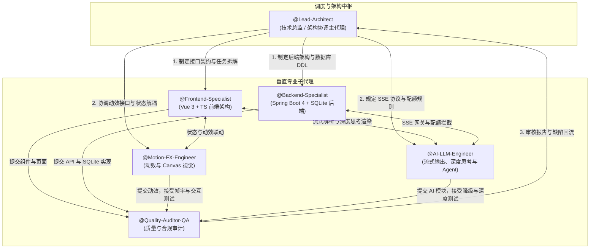

# XCWeb（Xtreme Cognitive Web）产品需求概要与多子代理协同手册

| 项目 | 内容 |
| :--- | :--- |
| 项目定位 | 面向 AI Native 交互场景的 Web 对话与智能体平台 |
| 技术栈 | 前端：Vue 3 + TypeScript + Tailwind CSS（Vite） 后端：Spring Boot 4.1.1 + JDK 21 + Maven + SQLite |
| 研发模式 | 六个子代理协同的多子代理研发体系（Multi-Agent Collaboration） |
| 代码仓库 | [GitHub - gyb0619/XCWeb](https://github.com/gyb0619/XCWeb.git) |
| 本地目录 | `D:\Code\Other\XCWeb` |
| 文档归档 | `D:\Code\Other\XCWeb\docs\PRD.md`、`D:\Code\Other\XCWeb\docs\PROMPTS.md` |

> 本手册描述研发组织方式与协同流程。完整的产品需求以 `PRD.md` 为准；各子代理的完整提示词与代码模板见 `PROMPTS.md`。三份文档出现冲突时，以 `PRD.md` 为最高优先级。

---

## 1. 协同拓扑

---

## 2. 子代理角色与分工

| 子代理 | 核心职责 | 输入 | 交付物 |
| :--- | :--- | :--- | :--- |
| `@Lead-Architect` （架构协调主代理） | 全局任务拆解、接口契约仲裁、前后端工程规范控制、版本推进 | PRD 业务需求与技术指标 | 接口契约、子代理任务工单、合并审计结论 |
| `@Frontend-Specialist` （前端核心） | 搭建 Vite + Vue 3 + TypeScript + Tailwind CSS 工程；Pinia 状态管理（四级角色与配额）；核心页面与组件 | 架构规范、后端接口契约 | 响应式组件树；零 TypeScript 错误的前端代码 |
| `@Motion-FX-Engineer` （动效与视觉） | 科技深邃蓝主题；Canvas 神经突触粒子背景；四项核心微动效（对角线扫屏、无损重试飞移、视差翻页、自适应内联编辑） | 前端组件 DOM 锚点、PRD 第 4 章动效规范 | 动效 Composable、SVG Polygon 扫屏组件、Canvas 粒子渲染器，以及减少动态效果的降级实现 |
| `@Backend-Specialist` （后端核心） | 独立 Spring Boot 4.1.1（JDK 21）工程；SQLite 建表；用户 JWT 与游客匿名令牌鉴权（令牌 + 指纹 + IP 三重校验）；配额拦截器；会话增量同步；管理员模型启停接口 | 数据模型 DDL、PRD 第 2、5 章 | 独立 Maven 工程；RESTful API；`429` 配额拦截与 `413` 上下文校验 |
| `@AI-LLM-Engineer` （流式与 Agent） | 对接硅基流动、智谱等预置模型；WebClient SSE 流式转发；深度思考事件规范化；Mock 降级；Agent 时间轴；端侧轻量 RAG | 上游模型 API、PRD 第 3、6 章 | 流式转发引擎、深度思考折叠组件、Mock 兜底器、Agent 时间轴、RAG 检索模块 |
| `@Quality-Auditor-QA` （质量与合规审计） | 全链路合规核查；断网降级测试；动效帧率检测；架构白皮书与演示视频脚本验收 | 各子代理交付物 | 质量审计报告、缺陷回归清单、交付物标准包 |

---

## 3. 协同规则

1. **契约优先**：任何跨代理的接口、数据结构或事件格式，须先由 `@Lead-Architect` 在契约中定稿，再进入开发。
2. **变更仲裁**：契约变更须由发起方提出，经 `@Lead-Architect` 仲裁后同步给所有相关代理，不允许单方修改。
3. **缺陷回流**：`@Quality-Auditor-QA` 发现的缺陷统一提交给 `@Lead-Architect`，由其分派至责任代理，修复后重新验收。
4. **安全约束**：API Key 只允许存在于服务端环境变量中；任何代理不得在前端代码、日志或文档中写入真实密钥。
5. **范围约束**：不提供自定义模型接口或自定义 Key 的功能；模型由服务端预置，管理员仅可启停与设置默认。

---

## 4. 研发流水线（五个阶段）

| 阶段 | 目标 | 主要执行者 | 阶段验收标准 |
| :--- | :--- | :--- | :--- |
| **阶段 1：骨架搭建与契约对齐** | 搭建前后端独立工程，对齐核心契约 | `@Backend-Specialist`：Spring Boot 4.1.1 + JDK 21 + SQLite `@Frontend-Specialist`：Vite + Vue 3 + Tailwind CSS + Pinia | 前后端均可独立启动；`User`、`GuestSession`、`Conversation`、`Message`、`Quota`、`SyncSettings`、`ModelInfo` 及 SSE 事件格式契约定稿 |
| **阶段 2：视觉重构与核心动效** | 完成登录页视觉与四项微动效，并交接给前端集成 | `@Motion-FX-Engineer` | Canvas 粒子登录页可用；四项动效符合 PRD 时长与位移规范，稳态不低于 55 FPS |
| **阶段 3：流式代理与深度思考** | 打通 SSE 流式管道与深度思考渲染 | `@AI-LLM-Engineer`、`@Frontend-Specialist`、`@Backend-Specialist` | 流式输出正常；思考内容进入独立抽屉并按规范折叠 / 滑升；配额按实际 `usage` 计入 |
| **阶段 4：高阶亮点开发** | 实现 Agent 时间轴、端侧 RAG、生成式 UI 与 Dev Console | `@AI-LLM-Engineer`：Agent 时间轴与 RAG `@Frontend-Specialist`：生成式 UI 与 Dev Console | 三项创新模块可演示；Dev Console 可查看脱敏后的请求记录与 Token 热力图 |
| **阶段 5：质量把控与合规验收** | 全链路测试与交付物验收 | `@Quality-Auditor-QA` | 断网 Mock 降级、游客第 11 次拦截及换令牌绕过测试、令牌篡改测试、帧率检测、白皮书与演示视频脚本均通过验收 |

---

## 5. 关联文档

- 完整产品需求：`D:\Code\Other\XCWeb\docs\PRD.md`
- 子代理完整提示词与代码模板：[PROMPTS.md](file:///D:/Code/Other/XCWeb/docs/PROMPTS.md)
